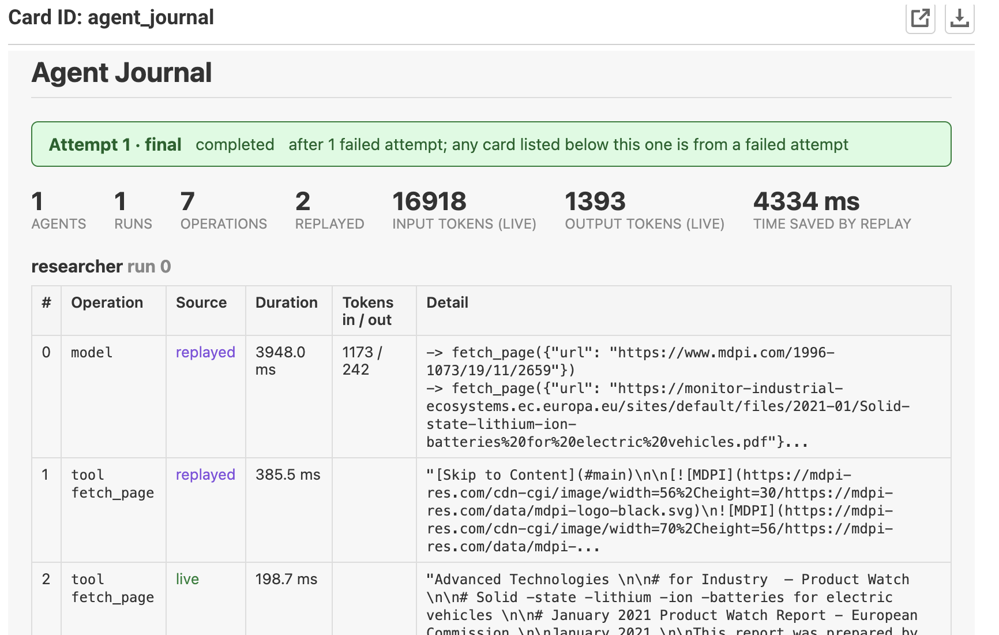

## Agent runs are long, expensive, and fragile

Agent runs are expensive in every sense of the word: model tokens, tool calls, and wall-clock time. And sometimes
you have to retry the run. Here is a typical research agent inside a Metaflow step:

```python
from metaflow import FlowSpec, Parameter, retry, step
from pydantic import BaseModel
from pydantic_ai import Agent
from pydantic_ai.common_tools.duckduckgo import duckduckgo_search_tool
from pydantic_ai.common_tools.web_fetch import web_fetch_tool


class Brief(BaseModel):
    summary: str
    sources: list[str]


researcher = Agent("openai:gpt-5", name="researcher", output_type=Brief,
                   tools=[duckduckgo_search_tool(), web_fetch_tool()])


class ResearchFlow(FlowSpec):
    topic = Parameter("topic")

    @retry(times=1)
    @step
    def start(self):
        # a failed fetch reruns every search and every model call
        self.brief = researcher.run_sync(self.topic).output
        self.next(self.end)

    @step
    def end(self):
        print(self.brief.summary)


if __name__ == "__main__":
    ResearchFlow()
```

Metaflow's `@retry` restarts the step when it fails. Without durability, the restart begins from
nothing: every search, every page fetch, and every model call the first attempt completed runs again.

## What durability means in Pydantic AI

Pydantic AI makes an agent durable by journaling each model and tool call, so a restarted run replays what
finished and resumes where it left off. Four ideas carry the design:

- **Operation** — each model request, tool call, and tool discovery is a named unit of work captured
  in the journal.
- **Capability** — attached to the `Agent`. It hands every operation to an engine's
  backend and manages everything else.
- **Identity** — stable operation names plus a hash of the inputs decide what can replay.
- **Serialization** — results are serialized to JSON so they can be stored in the journal and
  returned on replay.

Pydantic AI already supports a range of durable engines (see the
[Durable Execution overview](https://pydantic.dev/docs/ai/capabilities/durable_execution/overview/));
MetaflowDurability is built on the same
[backend builder](https://pydantic.dev/docs/ai/capabilities/durable_execution/backends/).

## Metaflow already has everything a durable agent needs

Durable engines usually bring their own infrastructure: workers, a server, and workflow code written in the
engine's style. Metaflow already provides the pieces a journal needs. A **task** is the unit of work,
an **artifact** is durable storage tied to that task, and **@retry** is the restart. So
no workers, server or workflow code: Metaflow's tasks, artifacts and retries are the engine.

The journal is saved as an artifact of the step, on success or on failure, and each retry reads the previous
attempt's journal back.

## The one-line change

```python
from metaflow import FlowSpec, Parameter, retry, step
from pydantic import BaseModel
from pydantic_ai import Agent
from pydantic_ai.common_tools.duckduckgo import duckduckgo_search_tool
from pydantic_ai.common_tools.web_fetch import web_fetch_tool

from metaflow_durability import MetaflowDurability


class Brief(BaseModel):
    summary: str
    sources: list[str]


researcher = Agent("openai:gpt-5", name="researcher", output_type=Brief,
                   tools=[duckduckgo_search_tool(), web_fetch_tool()],
                   capabilities=[MetaflowDurability()])  # <- the one-line change


class ResearchFlow(FlowSpec):
    topic = Parameter("topic")

    @retry(times=1)
    @step
    def start(self):
        # a failed fetch replays finished calls, then runs the rest live
        self.brief = researcher.run_sync(self.topic).output
        self.next(self.end)

    @step
    def end(self):
        print(self.brief.summary)


if __name__ == "__main__":
    ResearchFlow()
```

There are no effective changes to existing agent usage:

| You | MetaflowDurability |
| --- | --- |
| Add `capabilities=[MetaflowDurability()]` | Journals every model and tool call |
| Run the flow as usual | Saves the journal with the Metaflow step, even when it fails |
| Keep `@retry` | Replays finished calls on the next attempt, runs the rest live |
| Open the Metaflow UI | Shows a live agent card on every step |

The source is on [GitHub](https://github.com/Anaconda-Labs/metaflow-durability). To install:

```bash
pip install "metaflow-durability[pydantic-ai]" "pydantic-ai-slim[openai,duckduckgo,web-fetch]"
```

## Multiple agents, no extra work

A step can call several agents, or the same agent several times. Give each agent its usual `name`
and add `MetaflowDurability()`; the backend journals each agent's calls separately and replays each one
on retry.

```python
from metaflow import FlowSpec, Parameter, retry, step
from pydantic import BaseModel
from pydantic_ai import Agent
from pydantic_ai.common_tools.duckduckgo import duckduckgo_search_tool
from pydantic_ai.common_tools.web_fetch import web_fetch_tool

from metaflow_durability import MetaflowDurability


class Brief(BaseModel):
    summary: str
    sources: list[str]


researcher = Agent("openai:gpt-5", name="researcher", output_type=Brief,
                   tools=[duckduckgo_search_tool(), web_fetch_tool()],
                   capabilities=[MetaflowDurability()])
writer = Agent("openai:gpt-5", name="writer",
               capabilities=[MetaflowDurability()])


class ReportFlow(FlowSpec):
    topic = Parameter("topic")

    @retry(times=1)
    @step
    def start(self):
        brief = researcher.run_sync(self.topic).output
        self.report = writer.run_sync(f"Write a report from: {brief.summary}").output
        self.next(self.end)

    @step
    def end(self):
        print(self.report)


if __name__ == "__main__":
    ReportFlow()
```

The name is the journal key, so each agent in a step needs a unique one.

## The journal card



An Agent Journal card is added to every step automatically. It refreshes live while the agent runs, and failed
attempts appear below the active or latest card, so you can see exactly what a retry replayed and what it ran
live.

## What's next

- **Resume** — continue an agent with a new message appended to its history.
- **Fork** — branch a new run from an agent's message history.
- **Checkpointing and filesystem** — explore integrations with Metaflow `@checkpoint` and
  Workspaces (persistent filesystems) in Pydantic AI.
- **Tool dispatch** — execute each tool call with its own resources, for parallel and isolated
  execution.

<div class="callout">
<div class="tag">Try it</div>

**[github.com/Anaconda-Labs/metaflow-durability](https://github.com/Anaconda-Labs/metaflow-durability)**
— install it, add one capability, keep your `@retry`.
Feedback is welcome on the [GitHub issues page](https://github.com/Anaconda-Labs/metaflow-durability/issues).

</div>
